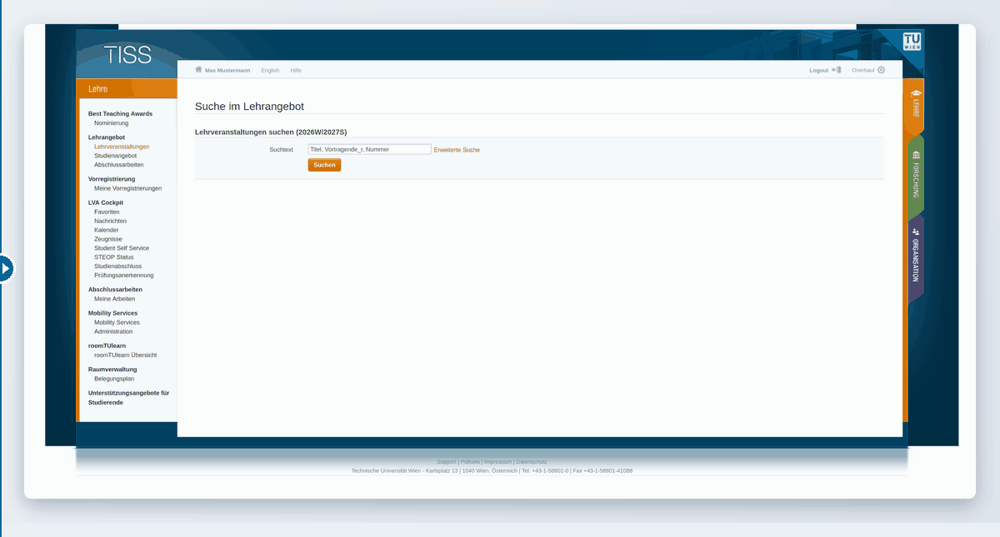
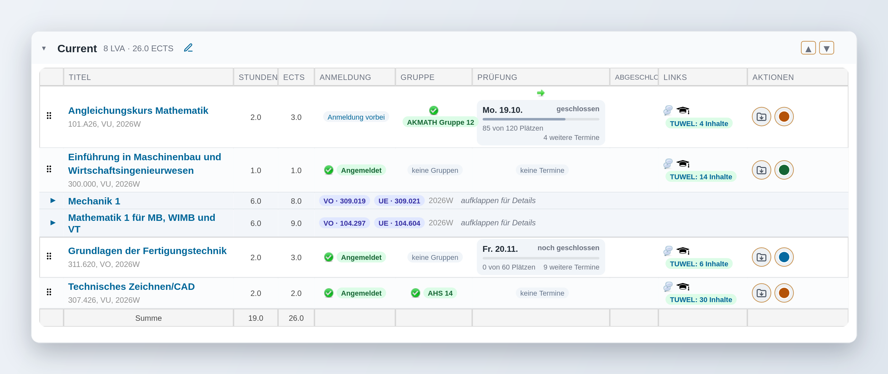
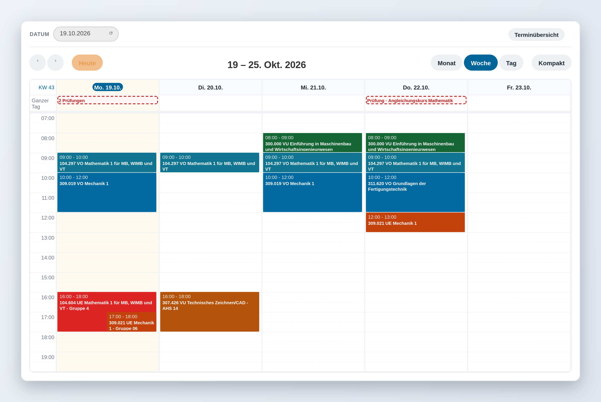

# TISS Overhaul

**A userscript that restyles and extends TU Wien's TISS** – the course, registration and calendar portal at [tiss.tuwien.ac.at](https://tiss.tuwien.ac.at). Works with Violentmonkey, Tampermonkey or Greasemonkey in Firefox, Chrome and Edge, including Firefox on Android.

Favoriten with live registration, group, exam and TUWEL status · colour-coded calendar with room and map links · offline calendar · registration countdown and automatic sign-up · typo-tolerant course search · a settings panel to switch any of it off.

> **How this is built:** the code is written by generative AI (Claude) under my direction; I'm a student, not a web developer. Every change is tried on a real TISS account before it's pushed, but it has not been code-reviewed by a professional. If AI-assisted development isn't your thing, no hard feelings – [TISS-Lightning-Registrator](https://github.com/The-breakbar/TISS-Lightning-Registrator) is a fine hand-written alternative for the registration part. Please [report](../../issues) anything that breaks.

## Screenshots

Drag it yourself: **[interactive before/after comparison](https://eletronitar.github.io/TISS-Overhaul/compare.html)**

| Favoriten | Calendar |
|---|---|
|  |  |

## Installation

1. Install a userscript manager: [Violentmonkey](https://violentmonkey.github.io/) (recommended; Firefox, Chrome, Edge, Firefox for Android), [Tampermonkey](https://www.tampermonkey.net/) or Greasemonkey.
2. Open [`tiss-overhaul.user.js`](https://raw.githubusercontent.com/Eletronitar/TISS-Overhaul/main/tiss-overhaul.user.js) – the manager offers to install it.
3. Reload TISS. The **Overhaul ⚙** gear in the top bar opens the settings.

Updates arrive automatically (`@updateURL` points at this file).

**TISS must be set to German.** The script reads TISS's own labels ("Anmeldung", "Prüfungen", "Externer Kalender", …) to find things on the page; with TISS in English most features silently do nothing. Switch the language in TISS's top bar.

## Features

**Design** – new header with the TU signet, colour-coded section tabs (Lehre / Forschung / Organisation), sidebar with a collapsible "Extras" block, pill buttons, full-width layout without inner scrolling.

**Favoriten** – collapsible and sortable categories, filter, compact view (VO/VU/UE of one course on one row), status badges for registration, groups, exams and TUWEL (fetched in the background), readable exam cards with capacity bar, a colour per course, move courses via a menu.

**Calendar** – a colour per course (warm = UE, mid = VU, cold = VO; override by hand), legend as filter chips with weekly hours, "next event" bar with room and a link to the TU map, custom event popup (room → Raumbelegung, exact map link, TUWEL, registration, exams), show only your own group, exams dashed and merged, compact mode, .ics download.

**Offline calendar** – `https://www.tuwien.at/tiss-offline` shows the last calendar snapshot even when TISS is down.

**Registration** – countdown to the opening, register button at the top, ⚡ automatic registration at the opening time.

**Search** – tidied form, fuzzy search (typo-tolerant), Studienangebot with collapsible faculties and ★ "my programmes".

**Session** – optional keep-alive so an open TISS tab doesn't idle out into another MFA login.

Every feature can be switched off individually in the settings; the top switch disables the script entirely.

## Planned

- **Student Self Service** – the same treatment as the rest of TISS
- **Zeugnisse** – a clearer certificates/grades page
- **Nachrichten** – a bell icon in the top bar that shows new messages at a glance
- **Polish** – smoothing out visual imperfections and making the design coherent across all pages
- Verifying the keep-alive option against TU's MFA re-login behaviour

Have something else in mind? See below.

## Bugs and feature requests

Both are welcome – [open an issue](../../issues). For a bug, say which TISS page you were on and add a screenshot; for a feature request, describe what you'd like and where in TISS it belongs. Ideas from other students shape what gets built next.

## Privacy

The script only talks to `tiss.tuwien.ac.at` and `tuwel.tuwien.ac.at` (background requests with your existing session). Nothing is sent to third parties. Settings, colours and the calendar snapshot stay in your browser (localStorage and userscript storage).

## Development

One file, no build step. `node --check tiss-overhaul.user.js` checks the syntax. The TU signets are embedded as data URIs.

The automatic registration is conceptually based on [TISS-Lightning-Registrator](https://github.com/The-breakbar/TISS-Lightning-Registrator) (GPL-3.0).

## License

[GPL-3.0](LICENSE)
